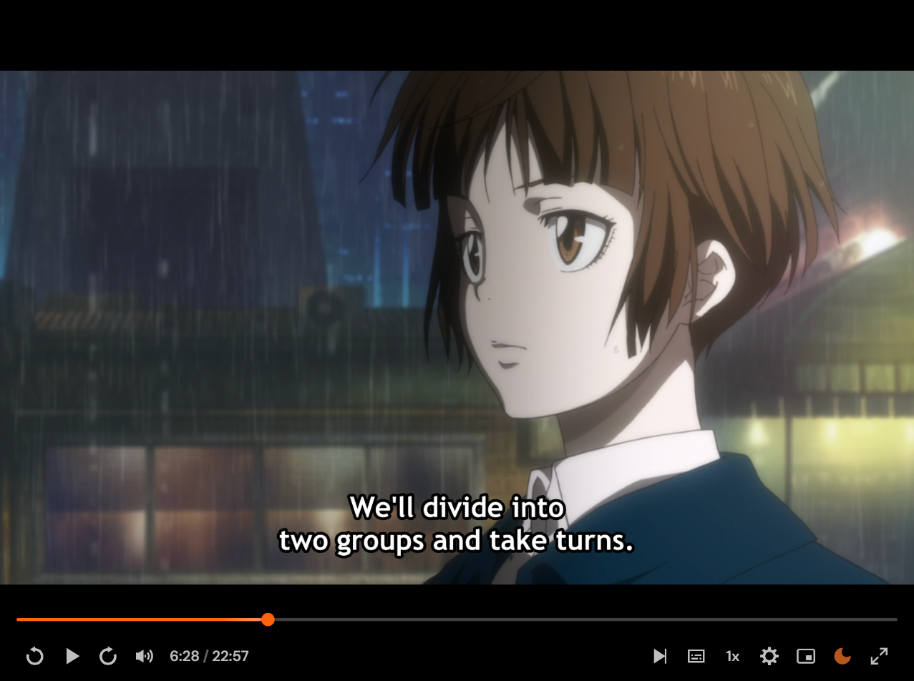

<p align="center">
  
</p>

<h1 align="center">Better Crunchyroll</h1>



A small Chrome extension that improves the Crunchyroll web player. It adds two buttons to the player's control bar, styled to match the native ones:

- **Cinema mode** (moon): the player fills the window with the picture full-width and centred, the controls sit below the picture instead of over the subtitles, and the rest of the page is darkened. The controls still auto-hide like the native player. The setting is remembered across episodes; Esc turns it off.
- **Pop-out player**: moves the whole player — video, subtitles and controls — into an always-on-top floating window (Document Picture-in-Picture), with the controls below the picture. Close the window to put the player back in the tab.

Works in Chrome and Chromium-based browsers such as Brave.

## Build & install

```sh
npm install
npm run build      # or: npm run watch
```

1. Open `chrome://extensions` and enable **Developer mode**.
2. Click **Load unpacked** and select the `extension/` folder.
3. After rebuilding, click the reload icon on the extension card and refresh Crunchyroll.

## Notes

- Crunchyroll's video is DRM-protected, so it shows as black in screenshots and screen recordings even when it plays normally.
- The extension finds the player by Crunchyroll's `data-testid` attributes, with generic fallbacks, so it may need updating if Crunchyroll changes its player.

Not affiliated with Crunchyroll.
